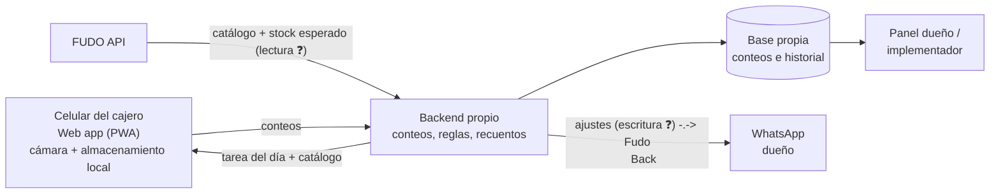

# App web de conteo de stock

**Documento de idea y especificación funcional**
Fecha: 20/10/2026 · Autor: Evaristo (Los Hornos), desarrollado con Claude
Complementa a: `desarrollo-api-fudo.md`

> **Marcas usadas en este documento**
> - ✅ **Confirmado**: verificado por documentación de FUDO o por uso real.
> - ⚠️ **Supuesto**: idea o inferencia a validar.
> - ❓ **Pendiente**: no se sabe todavía; hay que investigarlo.

---

## 1. Resumen

Una **página web pensada para el celular** con la que el cajero de un comercio cuenta el stock escaneando los productos con la cámara. Le dice qué contar ese día, lo guía góndola por góndola, no le muestra cuánto *debería* haber (conteo a ciegas) y al terminar le avisa al dueño si algo no cierra.

**Por qué importa:** en el servicio de implementación de FUDO, la parte más difícil de sostener no es la configuración, es que el empleado cuente bien, todos los días y a tiempo. Si contar es largo y tedioso, se hace mal o no se hace, y el control de stock pierde sentido. Esta herramienta busca que el conteo diario lleve **menos de 10 minutos** ⚠️ (objetivo, no medido).

**Por qué web y no app:** no hay que instalar nada ni pasar por tiendas de aplicaciones; se abre con un link desde el celular del local o del empleado. Se puede "agregar a la pantalla de inicio" para que parezca una app.

---

## 2. El problema

| Problema | Consecuencia |
|---|---|
| Contar todo el local lleva horas | No se hace, o se hace "a ojo" |
| Buscar cada producto en una lista es lento y confuso (mismo producto, distinto sabor o tamaño) | Errores de carga que parecen faltantes |
| Si el cajero ve cuánto debería haber, puede "ajustar" el número | El control deja de servir |
| Nadie sabe si se contó o no | El dueño vuelve a vigilar en persona |
| No se carga el ingreso de mercadería | Faltantes falsos y pérdida de confianza en el sistema |

---

## 3. Objetivos

1. Que el conteo diario lleve **menos de 10 minutos** ⚠️.
2. Que el cajero **no tenga que pensar** qué contar: la app se lo dice.
3. **Conteo a ciegas** siempre.
4. Cero tipeo de nombres: **escanear y poner la cantidad**.
5. Que el dueño sepa, sin ir al local, **si se contó y si cerró**.
6. Funcionar aunque falle internet en el local.

---

## 4. Usuarios

| Usuario | Qué hace en la app |
|---|---|
| **Cajero** | Hace los conteos del día. Ve solo su tarea; nunca ve stock esperado ni diferencias en números |
| **Dueño** | Recibe el resultado (WhatsApp o panel), ve diferencias, aprueba recuentos |
| **Implementador** (Evaristo) | Configura listas de riesgo, calendario rotativo y umbrales para cada cliente; ve el estado de todos sus clientes |

---

## 5. Esquema de conteo (la lógica de negocio)

Ya acordado en la implementación: **no se cuenta todo todos los días; se cuenta por riesgo.**

| Tipo | Qué se cuenta | Cuándo | Quién | Duración objetivo ⚠️ |
|---|---|---|---|---|
| **Diario (alto riesgo)** | 30–50 artículos de alto valor o alto robo: cigarrillos, alcohol, energizantes, chocolates caros, pilas, preservativos | En cada cambio de turno | Cajero saliente + entrante, juntos | < 10 min |
| **Rotativo** | Un sector o góndola por día (lunes bebidas sin alcohol, martes snacks, etc.) | Una vez por día | Cajero de turno | 10–15 min |
| **Completo** | Todo el local | Mensual | Cajero + dueño | Variable |
| **Puntual** | Un artículo o grupo que dio diferencia | Cuando lo pide el dueño o el sistema | Cajero de turno | 2–3 min |

La app arma automáticamente la tarea del día combinando el diario + el sector rotativo que toca.

---

## 6. Funcionalidades

### 6.1 Escaneo con la cámara del celular
- Se escanea el código de barras y aparece el producto con **nombre y foto** para confirmar que es el correcto.
- Si el producto no está en la lista del día, la app avisa ("Este producto no se cuenta hoy") y permite contarlo igual como extra.
- Si el código no existe en el catálogo, permite marcarlo como "producto no cargado" con una foto, para que el implementador lo dé de alta.
- **Opciones técnicas a evaluar** ⚠️: API nativa `BarcodeDetector` del navegador (funciona en Chrome Android; en iPhone/Safari no hay soporte confiable ❓ verificar) o librerías JavaScript como ZXing o html5-qrcode, que funcionan en ambos.
- Alternativa: lector de códigos Bluetooth conectado al celular, para locales que prefieran no usar la cámara.

### 6.2 Carga de cantidad rápida
- Al escanear, se abre un teclado numérico grande.
- Botones **+1 / +6 / +12 / +24** para productos que vienen en packs o cajas.
- Opción "escanear cada unidad": cada escaneo suma 1 (útil para pocas unidades sueltas).
- Distinguir **unidades sueltas vs. cajas cerradas**: "3 cajas de 12 + 5 sueltos" → 41. La equivalencia viene del catálogo ⚠️ (depende de cómo se modele en FUDO ❓).

### 6.3 Guía por góndola
- La lista del día viene **ordenada en el recorrido físico del local** (góndola 1, estante 1, de izquierda a derecha). El implementador define ese orden una sola vez, al hacer la carga inicial.
- Barra de progreso: "Llevás 23 de 41".
- Lo que falta contar queda resaltado; lo contado, tildado.
- Si un producto no está en góndola, botón **"No hay ninguno"** (cuenta 0, no es lo mismo que "no lo encontré").

### 6.4 Conteo a ciegas
- El cajero **nunca ve** el stock esperado ni la diferencia en números.
- **Recuento automático:** si un artículo difiere más que un umbral configurable, la app pide "Volvé a contar este producto" **sin decir si sobra o falta**. Se guarda el primer conteo y el segundo. Esto filtra errores honestos sin dar pistas.
- Si el segundo conteo confirma la diferencia, queda registrada y se informa al dueño.

### 6.5 Conteo de cambio de turno (dos personas)
- El conteo diario lo hacen el cajero que sale y el que entra.
- Ambos se identifican en la app (PIN o usuario).
- Al cerrar, los dos confirman. Desde ese momento, lo que falte en el turno siguiente es responsabilidad del que entra.

### 6.6 Funcionamiento sin internet
- El catálogo y la tarea del día se descargan al abrir la app.
- Si se corta internet a mitad del conteo, se sigue contando y se sincroniza al volver la conexión (técnicamente: PWA con almacenamiento local ⚠️).

### 6.7 Cierre y resultado
- Al terminar, resumen para el cajero: "Conteo completo. 41 productos, 2 recuentos." (sin números de diferencia).
- Para el dueño, por WhatsApp o panel:
  > Conteo turno tarde completo (8 min). Diferencias: Marlboro Box 20: faltan 2. Fernet 750: falta 1. Todo lo demás cerró.
- Si el conteo **no se hizo** a la hora prevista, aviso al dueño: "No se hizo el conteo del cambio de turno de las 15 h."

### 6.8 Ingreso de mercadería (opcional, fase 2)
- Mismo mecanismo de escaneo para cargar lo que llega del proveedor: escanear, poner cantidad, confirmar.
- Ataca el punto débil detectado: si las compras no se cargan, el stock esperado está mal y aparecen faltantes falsos.

### 6.9 Para que el empleado lo haga (adopción)
- Cronómetro visible: "Hoy tardaste 7 min" (ayuda a que se perciba como algo corto).
- Racha de conteos completos y a tiempo, visible para el dueño; base para un premio o incentivo si el dueño quiere ⚠️.
- Interfaz mínima: una sola pantalla principal con el botón "Empezar conteo de hoy".

---

## 7. Pantallas (MVP)

1. **Ingreso:** elegir usuario + PIN.
2. **Inicio:** "Conteo de hoy: Alto riesgo + Góndola 3 · 41 productos" → botón **Empezar**.
3. **Escaneo:** cámara activa arriba; abajo, último producto escaneado con foto y nombre.
4. **Cantidad:** teclado numérico grande + botones de pack.
5. **Lista / progreso:** pendientes y contados, en orden de góndola.
6. **Recuento:** "Volvé a contar este producto" con foto.
7. **Cierre:** resumen y confirmación (doble confirmación en cambio de turno).

**Para el implementador / dueño (puede ser una versión simple al principio):**
8. Configuración de lista de alto riesgo, calendario rotativo, orden de góndolas y umbrales de recuento.
9. Historial de conteos y diferencias por artículo y por cajero.

---

## 8. Integración con FUDO

FUDO es la fuente del catálogo, de las ventas y del stock esperado. La app necesita:

| Necesidad | Cómo | Estado |
|---|---|---|
| Catálogo con códigos de barras | API de FUDO o export/import Excel de productos | Excel ✅ / API ❓ |
| Stock esperado de cada artículo al momento del conteo | API de FUDO (lectura) | ❓ Verificar que se pueda consultar stock actual por artículo |
| Ventas desde el último conteo (alternativa para calcular el esperado) | API de FUDO (lectura) | ❓ |
| Registrar el conteo o el ajuste de stock en FUDO | API de FUDO (escritura) | ❓ **Crítico** |

### Si la API de FUDO NO permite escribir
La app funciona igual como **herramienta de control**: guarda los conteos en su propia base, calcula diferencias contra el stock leído de FUDO y alerta. El ajuste dentro de FUDO se hace aparte:
- a mano, por el dueño o el implementador, solo para los artículos con diferencia (pocos), o
- generando un archivo para importar, si FUDO lo permite ❓.

### Momento del conteo vs. ventas en curso
Si el local sigue vendiendo mientras se cuenta, el esperado cambia. Opciones:
- Contar en el cambio de turno, con el local tranquilo (lo más simple).
- Registrar la hora exacta de cada producto contado y calcular el esperado a esa hora ⚠️ (depende del detalle de ventas que dé la API ❓).

---

## 9. Arquitectura sugerida

Stack, hosting y proveedor de WhatsApp: ❓ a definir por el desarrollador. Requisito: multi-cliente desde el inicio (cada comercio con su catálogo, listas y usuarios).

---

## 10. Alcance por fases

### MVP (para el piloto en el drugstore)
- Ingreso con PIN.
- Lista de alto riesgo fija configurada a mano.
- Escaneo con cámara + carga de cantidad.
- Conteo a ciegas con recuento automático.
- Resultado al dueño por WhatsApp (o, si complica, por mail o panel simple).
- Stock esperado leído de FUDO; si no se puede por API, cargado desde un export ⚠️.

**Prueba piloto acordada:** empezar con cigarrillos y bebidas alcohólicas durante 2–3 semanas.

### Fase 2
- Calendario rotativo por góndola.
- Conteo de cambio de turno con dos personas.
- Modo sin internet.
- Aviso de conteo no realizado.
- Ingreso de mercadería por escaneo.

### Fase 3
- Escritura de ajustes en FUDO (si la API lo permite).
- Historial y ranking de diferencias por cajero.
- Panel del implementador con todos los clientes.
- Probarlo también en las 5 sucursales de Los Hornos.

---

## 11. Riesgos y puntos abiertos

| # | Tema | Estado |
|---|---|---|
| 1 | Si la API de FUDO deja leer el stock actual por artículo | ❓ Bloqueante para calcular diferencias automáticamente |
| 2 | Si la API deja escribir ajustes | ❓ Define si el ajuste es automático o manual |
| 3 | Escaneo con cámara en iPhone y celulares de gama baja | ⚠️ Probar con los celulares reales del local |
| 4 | Productos sin código de barras (sueltos, comida) | Buscar por nombre o foto en la lista |
| 5 | Equivalencias caja/unidad | ❓ Depende del modelado en FUDO |
| 6 | Que el cajero no use la app | Mitigar con conteo corto, aviso de conteo no realizado y racha visible para el dueño |
| 7 | Ventas durante el conteo | Contar en cambio de turno |
| 8 | Que el empleado use su propio celular | Definir con el dueño; alternativa: un celular del local |

---

## 12. Métricas para saber si funciona

- Tiempo promedio del conteo diario (objetivo < 10 min ⚠️).
- % de conteos hechos a tiempo.
- % de recuentos que corrigen el primer conteo (mide errores honestos).
- Diferencias de stock en pesos por semana: deberían bajar en las primeras semanas.
- Horas por día que el dueño deja de estar en el local (el argumento de venta).

---

## 13. Próximos pasos

1. **Desarrollador:** confirmar puntos 1 y 2 de la sección 11 con la documentación de la API de FUDO.
2. **Desarrollador:** prueba rápida de escaneo con cámara en una página web, en Android y en iPhone.
3. **Evaristo:** definir con el dueño del drugstore la lista de alto riesgo (30–50 artículos) y el orden de góndolas.
4. **Evaristo:** averiguar qué celular se usaría en el local.
5. **Ambos:** armar el MVP para el piloto de cigarrillos y alcohol.
